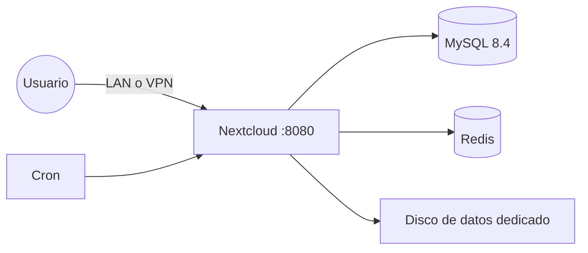

# Homelab Nextcloud


Nube personal autoalojada (alternativa a Google Drive) con Nextcloud, MySQL y Redis, desplegada con `docker compose` en una VM Ubuntu Server sobre Proxmox VE. Los datos viven en un disco virtual dedicado, separado del sistema, y el acceso desde fuera de casa se hace por VPN (Tailscale), sin abrir puertos en el router.

## Arquitectura



| Servicio | Imagen | Función |
|---|---|---|
| `app` | `nextcloud:33-apache` | Aplicación web y almacenamiento de archivos |
| `db` | `mysql:8.4` | Base de datos |
| `redis` | `redis:7-alpine` | Caché y bloqueo de archivos |
| `cron` | `nextcloud:33-apache` | Tareas en segundo plano |

## Requisitos previos

- VM con Docker y Docker Compose instalados.
- Un disco adicional para los datos, montado en `/srv/nextcloud-data`:

```bash
lsblk                                   # identifica el disco nuevo (p. ej. /dev/sdb)
sudo mkfs.ext4 /dev/sdb                 # ¡confirma antes que es el disco vacío!
sudo mkdir -p /srv/nextcloud-data
sudo blkid /dev/sdb                     # copia el UUID
echo 'UUID=<uuid> /srv/nextcloud-data ext4 defaults 0 2' | sudo tee -a /etc/fstab
sudo mount -a
sudo chown -R 33:33 /srv/nextcloud-data # usuario www-data del contenedor
```

## Puesta en marcha

```bash
git clone https://github.com/CoKayn22/homelab-nextcloud.git
cd homelab-nextcloud
cp .env.example .env
nano .env            # define contraseñas fuertes y tu IP en NEXTCLOUD_TRUSTED_DOMAINS
docker compose up -d
docker compose logs -f app
```

El primer arranque tarda un par de minutos. Después abre `http://<IP_de_la_VM>:8080`.

## Después de la instalación

1. **Tareas en segundo plano**: Administración → Ajustes básicos → *Cron* (el contenedor `cron` ya las ejecuta).
2. **HTTPS**: recomendado con un proxy inverso delante (siguiente fase del homelab).
3. **Móvil**: instala la app de Nextcloud y activa la subida automática de fotos.

## Seguridad

- Las credenciales van en `.env`, que no se sube al repositorio (ver `.gitignore`).
- El servicio no se expone a internet: el acceso remoto es por VPN.
- Actualiza con `docker compose pull && docker compose up -d`. Nextcloud solo permite subir una versión mayor cada vez.

## Copias de seguridad

Los snapshots de Proxmox en el mismo disco físico no son una copia de seguridad. Para datos irreemplazables como fotos, mantén una copia en otro dispositivo. Volcado de la base de datos:

```bash
docker compose exec -T db sh -c 'exec mysqldump -uroot -p"$MYSQL_ROOT_PASSWORD" --single-transaction nextcloud' > backup.sql
```

## Troubleshooting

*(añadir aquí las incidencias encontradas y su solución)*

## Licencia

MIT, ver [LICENSE](LICENSE)
